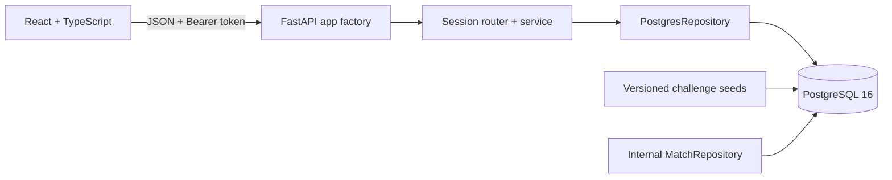

# Architecture and integration boundaries

The server owns identity, roles, phase, round and future win decisions. React
renders authorized state. PostgreSQL persists identities, assignments, challenge
content and match records across processes. No production in-memory fallback.

## Source map

| Location | Purpose |
|---|---|
| frontend/src | Priyanshi's React routes, live/mock API adapters, lobby and unit tests |
| frontend/e2e | Four independent Chromium players against the real API |
| backend/app/main.py | App factory, readiness/lifespan, shared middleware, session mounting |
| backend/app/config.py | Explicit environment settings, no credentials in representations |
| backend/app/sessions | Validated DTOs, session rules, persistence protocol and PostgreSQL adapter |
| backend/app/db | Checksummed migrations and deterministic immutable seed commands |
| backend/migrations | Forward and reverse PostgreSQL schema |
| backend/data | Ten server-only challenge definitions/answer keys |
| backend/app/matches.py | Atomic internal result write/read |
| backend/tests | Unit, real PostgreSQL, concurrency, persistence and application tests |
| .github/workflows | Backend, frontend and four-player integration CI |

The original frontend and CI commits were merged into `jiya`, preserving authors.
The user's 2026-11-17 request consolidates remaining Phase 1 implementation there;
this does not transfer ownership of later gameplay tasks or alter other branches.

## Transactions, lifecycle and security

Each operation opens a new psycopg connection at READ COMMITTED. Join/start use
FOR UPDATE on the session row; lobby reads use FOR SHARE. Adapter operations
commit before success, roll back failures and release connections/locks. The
repository interface remains usable by isolated fake tests. Real tests exercise
distinct connections and independent Python processes.

App startup verifies a live SQL connection and migration version. Migrations
are explicit administrative commands. Health failures and unexpected errors use
safe envelopes; the API bounds body buffering and allows only configured origins.
The browser holds a private bearer token per tab. Room codes never authenticate.
Answer keys stay under backend/data and out of safe queries, DTOs and OpenAPI.

Gameplay state retrieval, timers, answers, voting, sabotage and public results
are planned Phase 2 endpoints. The database schema is foundation, not evidence
that those endpoints or the resolution engine already exist.
