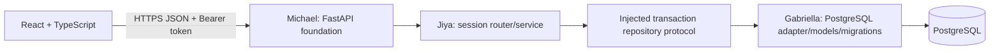

# Architecture and integration boundaries

## Data flow and authority

The backend owns identity, roles, phase, round, progress, authorization, and wins.
React displays authorized server state. PostgreSQL is the production source of
truth across processes/restarts. A room code locates a room, never authenticates.
Host permission and secret role are independent. No special non-Mafia abilities
exist in the MVP.

## Directories and owners

| Location | Purpose/owner |
|---|---|
| `frontend/` | Priyanshi's React/TypeScript application and Vitest tests; placeholder retained |
| `backend/app/` | Michael's future app/bootstrap/shared infrastructure; placeholder retained |
| `backend/app/sessions/` | Jiya's DTOs, service, repository protocol, router factory |
| `backend/tests/` | Jiya's isolated fake repository and focused session tests |
| Production models/migrations | Gabriella chooses their location and implementation |
| `.github/` | Shared PR/issue templates; Michael owns future CI workflows |
| `docs/` | Architecture, integration contracts, issues, QA and weekly status |
| Root spec/API | Jiya's shared game rules and stable proposed transport contracts |

The original `Readme.md` and seven setup files are preserved. No production
FastAPI app, frontend replacement, engine, permanent schema, migration, or
deployment configuration is introduced by this session component.

## Session boundaries

`SessionService` depends on the repository protocol in
`backend/app/sessions/repository.py`. The router factory accepts a FastAPI
dependency returning that service. Immutable domain records are separate from
Pydantic transport models; responses explicitly select permitted fields.

The injected repository opens one transaction per service operation. Create
commits room+host or nothing, and retries uniqueness collisions using a fresh
transaction. Join and start lock the same room row before checking state.
Lobby reads acquire a shared lock for a consistent membership/phase snapshot.
The adapter commits before a response is returned and releases locks on every
exit. Failure rolls back all changes. Database details remain Gabriella's choice.

The test fake uses one process-wide repository-instance lock and snapshot rollback.
It is intentionally kept under `backend/tests`, unavailable as a production
fallback. Passing tests do not demonstrate PostgreSQL locking, crash persistence,
driver error mapping, SQL constraints, or correctness across multiple workers.

## Security boundaries

Tokens have 256 bits of entropy; only SHA-256 digests cross the persistence
interface. An authenticated member can read only their own room. Only its host
can start. Roles use `secrets.SystemRandom`, with four assignments and the first
phase/round committed in one operation. No other player's role appears in lobby
or start responses. The host receives only their own role from start.

The planned authenticated `/state` endpoint will let each non-host retrieve
their own role; it is outside Week 11 sessions. Answer keys never enter the
session interface. Responses and validation errors avoid echoing private data.
Session responses disable caching. Production logs must redact credentials.

Michael integrates shared errors, authentication conventions, HTTPS/CORS,
request limits, rate limiting, observability, and deployment configuration.
Gabriella implements token-hash uniqueness, membership constraints, role
uniqueness, transactions and row locks. Priyanshi avoids token-in-URL storage,
raw HTML rendering of names, automatic duplicate join on refresh, and any
client-side authority over game state. Browser token-storage policy is PROPOSED.

## Integration sequence and release gates

1. Team reviews SPECIFICATION.md and API.md and records proposed-policy approvals.
2. Gabriella supplies models, migrations, constraints, and a repository adapter.
3. Michael supplies the shared FastAPI app and registers the service dependency
   and session router; shared error handling must preserve API envelopes.
4. Run repository conformance tests against PostgreSQL, apply migrations to an
   empty database, and verify atomic failures, collisions and concurrent requests.
5. Priyanshi connects create/join/lobby/start views and tests four browser clients.
6. Test complete gameplay and persistent completed history in later weeks before
   calling the full MVP complete or deploying publicly.

Exact adapter semantics and mounting examples are in
[SESSION_INTEGRATION.md](SESSION_INTEGRATION.md). No production integration,
GitHub issue, CI setting, approval, or deployment is implied by these documents.
